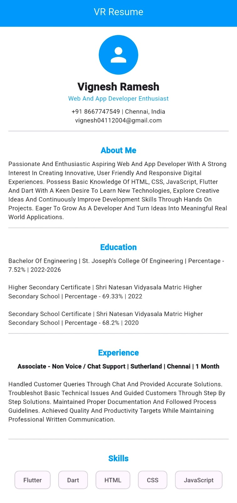
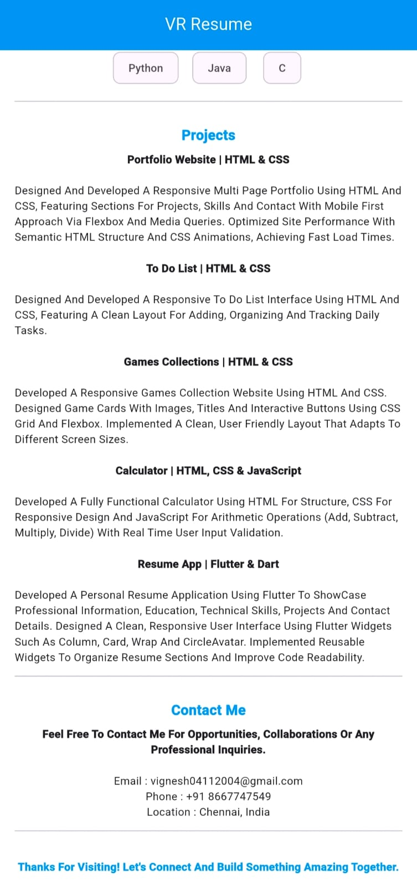

📄 My Resume App – Flutter

📌 About the Project

My Resume App is a simple mobile application developed using Flutter and Dart. It showcases my personal profile, education, experience, skills, projects and contact information in a clean and user-friendly interface.

This project helps me improve my Flutter development skills and learn how to build mobile applications.

✨ Features

- 🏠 Home section
- 👤 About Me
- 🎓 Education details
- 💼 Experience
- 🛠️ Technical Skills
- 📂 Projects
- 📞 Contact Information
- 🎨 Simple and clean user interface
- 📱 Mobile-friendly design

🛠️ Technologies Used

- Flutter – UI development framework
- Dart – Programming language
- Visual Studio Code – Code editor

🚀 Getting Started

Prerequisites

- Flutter SDK
- Dart SDK
- Visual Studio Code or Android Studio

🔗 Live Demo

[View Project](https://vignesh-0411.github.io/vr-resume-app/)

📸 Screenshots

🎯 Learning Outcomes

- Understanding Flutter widgets
- Using Scaffold, AppBar, Container and Card
- Styling text with TextStyle
- Applying padding and margins
- Organizing a Flutter project
- Building a personal resume application

👨‍💻 Developer

Vignesh Ramesh

Aspiring Web and Mobile App Developer with a strong interest in learning new technologies and building useful applications.

🙏 Acknowledgement

Thank you for visiting my project!

If you find this project useful, feel free to ⭐ the repository.
